---

# 🧑‍💻 Portfólio Profissional 🚀

> [!NOTE]
> Website de portfólio profissional **bilíngue (PT/EN)**, com linha do tempo de projetos, histórico de experiências e formulário de contato com **envio real de e-mail**. Construído com **Next.js 16**, **TypeScript** e **Tailwind CSS 4**, e hospedado gratuitamente na nuvem.

<table>
  <tr>
    <td width="800px">
      <div align="justify">
        Este repositório contém o <b>Laboratório 01</b> da disciplina <b>Desenvolvimento e Integração de Aplicações Web (DIAW)</b> do curso de <b>Engenharia de Software da PUC Minas</b>. O objetivo é projetar e desenvolver um <i>website de portfólio profissional</i> completo — do <b>wireframe</b> ao <b>deploy em nuvem</b> — contemplando <i>front-end</i>, <i>back-end</i> e <i>hospedagem</i>. O site apresenta quatro seções acessadas por um menu de navegação: <b>Sobre Mim</b> (em português e inglês), <b>Projetos</b> (linha do tempo do mais antigo ao mais recente), <b>Experiências</b> e <b>Contato</b> (ícones clicáveis e formulário funcional com envio por e-mail). Todo o conteúdo editorial é centralizado em arquivos de dados tipados, o que permite atualizar o portfólio sem tocar em nenhum componente de interface.
      </div>
    </td>
    <td>
      <div>
        
      </div>
    </td>
  </tr>
</table>

> [!IMPORTANT]
> **Ainda falta preencher:** o **link do protótipo no Figma** nos *Links Úteis*. As imagens dos seis projetos já são capturas reais; `node scripts/valida-capturas.mjs` confere proporção e peso de cada uma.

---

## 🚧 Status do Projeto

[](https://github.com/GustavoAlbuquerquee/portfolio-profissional/actions/workflows/ci.yml)
[](https://github.com/GustavoAlbuquerquee/portfolio-profissional/releases)


**Situação atual:** ✅ Lab01S01 (planejamento e protótipo) · ✅ Lab01S02 (funcionalidades) · ✅ Lab01S03 (hospedagem e finalização)

---

## 📚 Índice
- [Links Úteis](#-links-úteis)
- [Sobre o Projeto](#-sobre-o-projeto)
- [Funcionalidades Principais](#-funcionalidades-principais)
- [Protótipos e Wireframes](#-protótipos-e-wireframes)
- [Tecnologias Utilizadas](#-tecnologias-utilizadas)
  - [Front-end](#-front-end)
  - [Back-end](#️-back-end)
  - [Infraestrutura & DevOps](#️-infraestrutura--devops)
  - [Dependências completas](#-dependências-completas)
- [Arquitetura](#-arquitetura)
- [Instalação e Execução](#-instalação-e-execução)
  - [Pré-requisitos](#pré-requisitos)
  - [Variáveis de Ambiente](#-variáveis-de-ambiente)
  - [Instalação de Dependências](#-instalação-de-dependências)
  - [Como Executar a Aplicação](#-como-executar-a-aplicação)
- [Deploy](#-deploy)
- [Estrutura de Pastas](#-estrutura-de-pastas)
- [Demonstração](#-demonstração)
- [Como Personalizar o Portfólio](#-como-personalizar-o-portfólio)
- [Testes](#-testes)
- [Documentações utilizadas](#-documentações-utilizadas)
- [Autores](#-autores)
- [Contribuição](#-contribuição)
- [Agradecimentos](#-agradecimentos)
- [Licença](#-licença)

---

## 🔗 Links Úteis

* 🌐 **Demo Online:** [Acesse o portfólio publicado](https://albuquerquee.dev)
  > 💻 **Descrição:** Aplicação Next.js completa em produção na Vercel, com a API Route de contato ativa.
* 🎨 **Protótipo no Figma:** [Wireframes de média fidelidade](https://www.figma.com/)
  > 🖌️ **Descrição:** Wireframes das quatro páginas (desktop e mobile). As versões exportadas estão em [`docs/wireframes/`](./docs/wireframes).
* 📖 **Documentação do Laboratório:** [DIAW — Prof. Dr. João Paulo Aramuni](https://github.com/joaopauloaramuni/desenvolvimento-e-integracao-de-aplicacoes-web)
  > 📚 **Descrição:** Repositório da disciplina, com enunciados, templates e materiais de apoio.

---

## 📝 Sobre o Projeto

**Por que ele existe.** Todo profissional de tecnologia precisa de um lugar próprio — fora de redes sociais e plataformas de terceiros — para mostrar quem é, o que já construiu e como ser contatado. Este projeto nasce dessa necessidade: um espaço sob controle total do autor, com identidade visual coerente e conteúdo que evolui junto com a carreira.

**Qual problema ele resolve.** Currículos em PDF envelhecem rápido, não mostram o produto funcionando e dificilmente comunicam a evolução técnica de alguém ao longo do tempo. Este portfólio resolve isso com uma **linha do tempo de projetos** (do mais antigo ao mais recente, com imagens das telas em funcionamento, stack e link para o repositório), uma seção de **experiências** classificada por tipo, e **canais de contato de um clique** acompanhados de um formulário que realmente entrega a mensagem na caixa de entrada.

**Qual o contexto.** Acadêmico e profissional ao mesmo tempo: é a entrega do Laboratório 01 da disciplina DIAW (PUC Minas), mas foi construído como um produto real, pronto para ser usado em processos seletivos.

**Onde ele pode ser utilizado.** Candidaturas a estágio e vagas júnior, assinatura de e-mail, bio do LinkedIn e do GitHub, networking em eventos técnicos.

**O que o torna relevante.**
- É **bilíngue de verdade**: cada texto existe em português e inglês e a troca é instantânea, sem recarregar a página, com a preferência salva no navegador.
- O conteúdo é **totalmente orientado a dados** — adicionar um projeto é adicionar um objeto em um array tipado.
- Tem **back-end próprio**: o formulário não depende de serviços pagos de terceiros, usa uma API Route com Nodemailer, validação em duas camadas, *rate limit* e proteção *honeypot* contra bots.

---

## ✨ Funcionalidades Principais

- 🌍 **Internacionalização (i18n) PT/EN:** todo o conteúdo — interface, biografia, projetos e experiências — existe nos dois idiomas. Troca instantânea via React Context, preferência persistida em `localStorage` e detecção automática do idioma do navegador no primeiro acesso.
- 🧑 **Sobre Mim:** apresentação com formação, área de atuação, interesses e objetivos profissionais, acompanhada de indicadores de destaque e do bloco de habilidades agrupadas por área.
- 🗂️ **Projetos com linha do tempo:** ordenação cronológica (do mais antigo ao mais recente, com botão para inverter), filtro por categoria e, em cada projeto, nome, descrição, destaques, **tecnologias utilizadas**, **link para o repositório no GitHub** e **imagem do projeto em funcionamento**.
- 💼 **Experiências:** experiências profissionais, estágios, freelas, projetos open source e eventos técnicos, com empresa/instituição, cargo ou atividade, período, local, descrição e realizações. Filtro por tipo e selo de "Atual".
- 📬 **Contato:** ícones clicáveis para e-mail, WhatsApp, LinkedIn e GitHub, com botão de copiar, mais um **formulário funcional** (nome, e-mail, assunto e mensagem) que envia a mensagem por e-mail.
- 🌐 **Globo de stacks:** as tecnologias distribuídas numa esfera pela espiral de Fibonacci, com os logos oficiais das marcas, perspectiva real (o que está na frente cresce e ganha nitidez), giro automático, arraste com inércia e filtro por área. Alterna com uma visão em lista, que é também o caminho acessível.
- 🏁 **Box ao vivo:** resultado real da última corrida de Fórmula 1 e o campeonato de pilotos, desenhados como torre de tempos. Os dados vêm da Jolpica F1 API, buscados **no servidor** com cache de uma hora (ISR): a página segue estática e rápida, e o visitante nunca espera a API externa. Falhas na fonte viram um aviso, sem quebrar a página.
- 📻 **Rádio do box:** faixa logo abaixo do herói com os últimos commits públicos (data, repositório, tipo e mensagem), rolando como o letreiro de uma transmissão. Os commits saem dos repositórios com push mais recente, buscados no servidor com cache de uma hora, sem merges e com no máximo quatro por repositório. Cada item abre o commit no GitHub; a faixa pausa no hover, no foco, no botão e fora da tela, e vira rolagem manual com `prefers-reduced-motion`. Repositórios listados em `githubHiddenRepos` (`src/data/profile.ts`) ficam de fora. Com `GITHUB_PRIVATE_TOKEN`, entram também até quatro commits das organizações privadas em `githubPrivateSources`, mostrados só como horário e "LITS · commit privado": mensagem, repositório e link nunca saem do servidor.
- 🏎️ **Identidade de telemetria:** régua de luzes de largada, placar de letras avulsas, linhas de velocidade no herói, mapa de passagens nas experiências e barra de progresso de leitura. Toda animação pausa fora da tela e respeita `prefers-reduced-motion`.
- ✅ **Validações:** validação em tempo real no cliente (React Hook Form) e revalidação no servidor com Zod, mensagens de erro traduzidas, contador de caracteres e feedback acessível via `aria-live`.
- 🛡️ **Proteção anti-spam:** campo *honeypot* invisível e limite de 5 envios por IP a cada 10 minutos na API Route.
- 🌓 **Tema claro/escuro:** alternância manual com persistência e respeito à preferência do sistema, sem piscar a tela no carregamento (script anti-FOUC).
- 📱 **Design responsivo:** layout fluido de 320 px a telas grandes, com menu lateral colapsável no mobile.
- ♿ **Acessibilidade:** navegação completa por teclado, *skip link*, foco visível, marcos semânticos, `aria-label`/`aria-current` e suporte a `prefers-reduced-motion`.
- 🔍 **SEO:** metadados por página, Open Graph, `theme-color` e HTML semântico.

---

## 🖼 Protótipos e Wireframes

Wireframes de média fidelidade das quatro páginas, alinhados à identidade visual implementada. Arquivos em [`docs/wireframes/`](./docs/wireframes), em SVG com texto editável e camadas nomeadas — arraste-os para dentro do Figma e eles entram como vetores editáveis, sem redesenhar nada.

| Sobre Mim | Projetos |
|-----------|----------|
| 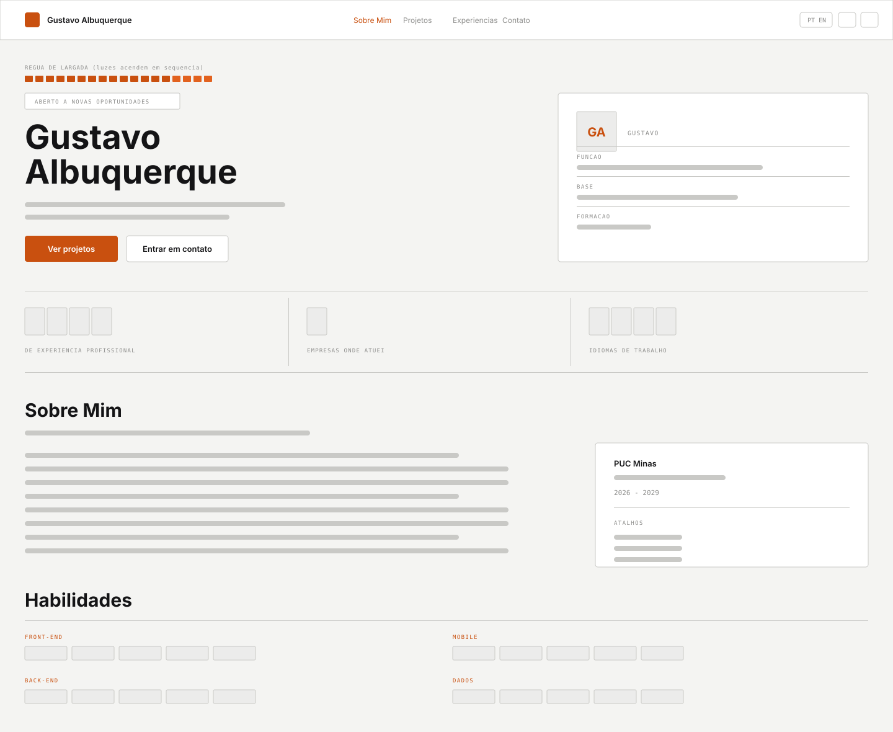 | 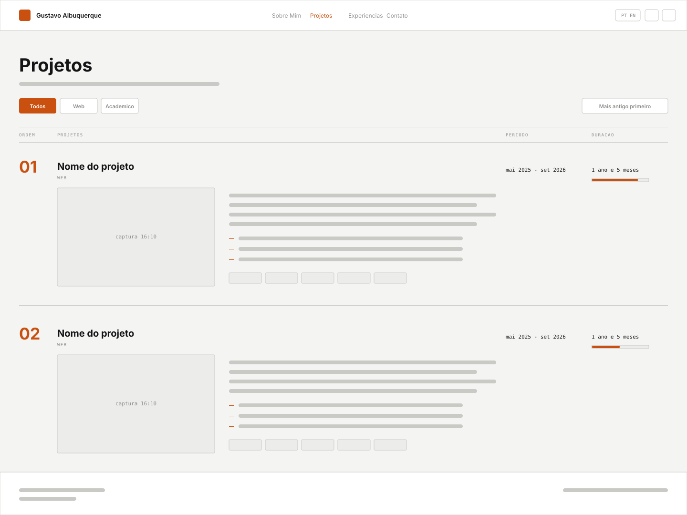 |

| Experiências | Contato |
|--------------|---------|
| 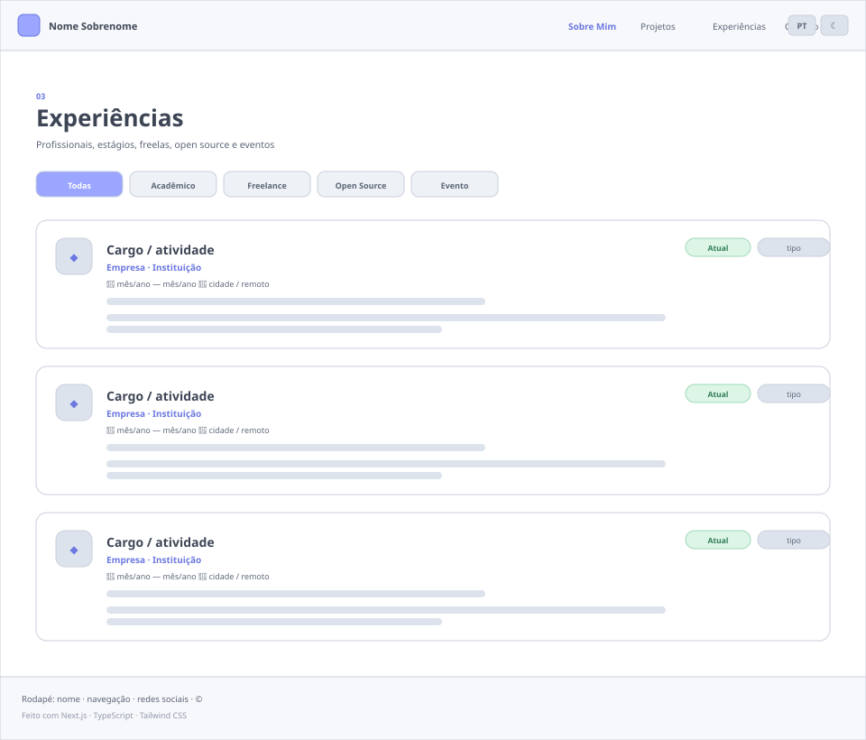 | 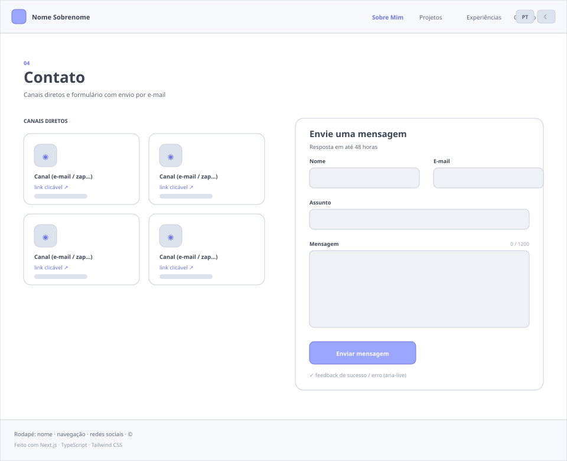 |

**Versão mobile (responsividade):**

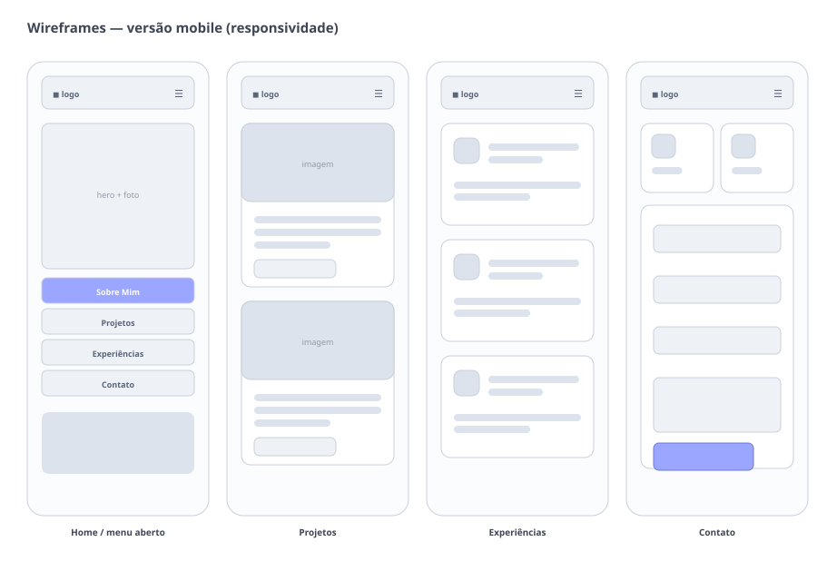

---

## 🛠 Tecnologias Utilizadas

As ferramentas, frameworks e bibliotecas abaixo foram utilizados na construção deste projeto. Recomenda-se o uso das versões listadas (ou superiores) para garantir a compatibilidade.

### 💻 Front-end

| Tecnologia | Versão | Função no projeto |
|------------|--------|-------------------|
| [**Next.js**](https://nextjs.org/) | 16.4.2 | Framework React full-stack (App Router, SSG, API Routes, otimização de imagens) |
| [**React**](https://react.dev/) | 19.3.0 | Biblioteca de construção da interface |
| [**TypeScript**](https://www.typescriptlang.org/) | 5.x | Tipagem estática em todo o código, inclusive nos dados de conteúdo |
| [**Tailwind CSS**](https://tailwindcss.com/) | 4.x | Estilização utilitária e *design tokens* via `@theme` |
| [**Motion**](https://motion.dev/) | 14.x | Animações de entrada, com respeito a `prefers-reduced-motion` |
| [**Lucide React**](https://lucide.dev/) | 1.x | Biblioteca de ícones SVG |
| [**React Bits**](https://reactbits.dev/) | — | Componentes de interação (`ClickSpark`, `DecryptedText`, `Magnet`, `PixelTransition`), em [`src/components/reactbits/`](./src/components/reactbits) |
| [**React Hook Form**](https://react-hook-form.com/) | 7.x | Gerenciamento e validação do formulário de contato |

### 🖥️ Back-end

| Tecnologia | Versão | Função no projeto |
|------------|--------|-------------------|
| [**Next.js API Routes**](https://nextjs.org/docs/app/building-your-application/routing/route-handlers) | 16.4.2 | Endpoint `POST /api/contact` (runtime Node.js) |
| [**Node.js**](https://nodejs.org/) | 22.x | Runtime de execução |
| [**Nodemailer**](https://nodemailer.com/) | 10.x | Envio de e-mail via SMTP |
| [**Zod**](https://zod.dev/) | 4.x | Validação e sanitização do payload no servidor |

### ⚙️ Infraestrutura & DevOps

| Tecnologia | Função no projeto |
|------------|-------------------|
| [**Vercel**](https://vercel.com/) | Hospedagem principal (aplicação Next.js completa, com a API de contato ativa) |
| [**GitHub Pages**](https://pages.github.com/) | Hospedagem alternativa (exportação estática), via workflow manual |
| [**GitHub Actions**](https://github.com/features/actions) | CI (lint, *type-check* e build) e deploy do GitHub Pages |
| [**ESLint**](https://eslint.org/) | Análise estática com `eslint-config-next` |
| [**Git**](https://git-scm.com/) | Controle de versão |

### 📦 Dependências completas

**Dependências de produção**

```jsonc
{
  "lucide-react":    "^1.59.0",   // ícones SVG
  "motion":          "^14.4.0",   // animações
  "next":            "16.4.2",    // framework
  "nodemailer":      "^10.1.7",   // envio de e-mail (SMTP)
  "react":           "19.3.0",    // biblioteca de UI
  "react-dom":       "19.3.0",    // renderizador DOM
  "react-hook-form": "^7.90.0",   // formulários
  "zod":             "^4.6.7"     // validação de schema
}
```

**Dependências de desenvolvimento**

```jsonc
{
  "@tailwindcss/turbopack": "^4",        // integração Tailwind + Turbopack
  "@types/node":            "^20",       // tipos do Node.js
  "@types/nodemailer":      "^8.0.2",    // tipos do Nodemailer
  "@types/react":           "^19",       // tipos do React
  "@types/react-dom":       "^19",       // tipos do React DOM
  "eslint":                 "^9",        // linter
  "eslint-config-next":     "16.4.2",    // regras do Next.js
  "tailwindcss":            "^4",        // framework CSS
  "typescript":             "^5"         // compilador TypeScript
}
```

---

## 🏗 Arquitetura

O projeto segue a arquitetura do **App Router** do Next.js, com separação explícita entre **dados**, **apresentação** e **estado global**.

```
┌──────────────────────────────────────────────────────────────────────┐
│                             NAVEGADOR                                │
│                                                                      │
│   ┌────────────────────────────────────────────────────────────┐     │
│   │  ThemeProvider  →  I18nProvider  (React Context)           │     │
│   │  · tema claro/escuro      · idioma PT/EN                   │     │
│   │  · persistido em localStorage                              │     │
│   └────────────────────────────────────────────────────────────┘     │
│        │                                                             │
│        ▼                                                             │
│   Header · <main> (páginas) · Footer                                 │
│        │                                                             │
│        │  /          → Sobre Mim + Habilidades                       │
│        │  /projetos  → Linha do tempo de projetos                    │
│        │  /experiencias → Histórico de experiências                  │
│        │  /contato   → Canais + formulário                           │
│        │                                                             │
│        └── fetch POST /api/contact ───────────────┐                  │
└───────────────────────────────────────────────────┼──────────────────┘
                                                    ▼
┌──────────────────────────────────────────────────────────────────────┐
│                      SERVIDOR (Node.js runtime)                      │
│                                                                      │
│   Route Handler  src/app/api/contact/route.ts                        │
│     1. Rate limit por IP (5 req / 10 min)                            │
│     2. Validação do payload com Zod                                  │
│     3. Checagem do honeypot                                          │
│     4. Envio via Nodemailer ──────────► Servidor SMTP ──► Caixa de   │
│                                                            entrada   │
└──────────────────────────────────────────────────────────────────────┘

         CAMADA DE DADOS (compartilhada, tipada, sem UI)
         src/data/profile.ts · projects.ts · experiences.ts · skills.ts
         src/i18n/dictionaries.ts  (textos de interface PT/EN)
```

**Decisões de arquitetura**

| Decisão | Justificativa |
|---------|---------------|
| Conteúdo em `src/data/*.ts` em vez de dentro dos componentes | Atualizar o portfólio não exige mexer em JSX; o TypeScript garante que nenhum campo obrigatório (nem a tradução) seja esquecido |
| i18n via Context em vez de rotas `/pt` e `/en` | A troca de idioma é instantânea, não duplica URLs e mantém o usuário exatamente na mesma posição da página |
| Tipo `Localized<T> = Record<"pt" \| "en", T>` | Torna **impossível** compilar o projeto com um texto traduzido pela metade |
| Páginas como Server Components finos, com uma *view* cliente | Os metadados (SEO) ficam no servidor e apenas a parte interativa vai para o cliente |
| Validação duplicada (React Hook Form + Zod) | Feedback imediato para quem usa, e garantia no servidor contra requisições forjadas |
| Script de tema injetado no `<head>` | Aplica o tema salvo antes da primeira pintura, eliminando o *flash* de tela branca |
| Fallback `mailto:` no formulário | O site continua útil mesmo em hospedagem estática, sem a API Route |

---

## 🔧 Instalação e Execução

### Pré-requisitos

| Requisito | Versão mínima | Verificação |
|-----------|---------------|-------------|
| [Node.js](https://nodejs.org/) | 20.9 (recomendado 22) | `node -v` |
| npm | 10 | `npm -v` |
| [Git](https://git-scm.com/) | 2.30 | `git --version` |

Opcional: uma conta SMTP (Gmail, Outlook, Brevo…) para o envio real de e-mails.

### 🔑 Variáveis de Ambiente

Copie o arquivo de exemplo e preencha os valores:

```bash
cp .env.example .env.local
```

| Variável | Obrigatória | Descrição | Exemplo |
|----------|-------------|-----------|---------|
| `SMTP_HOST` | sim | Endereço do servidor SMTP | `smtp.gmail.com` |
| `SMTP_PORT` | não (padrão `587`) | Porta do SMTP (`465` ativa TLS implícito) | `587` |
| `SMTP_USER` | sim | Conta que autentica e assina o envio | `seu-email@gmail.com` |
| `SMTP_PASS` | sim | Senha do SMTP — no Gmail, uma **Senha de app** | `abcd efgh ijkl mnop` |
| `CONTACT_TO` | não (padrão `SMTP_USER`) | Caixa que recebe as mensagens | `seu-email@gmail.com` |

> [!WARNING]
> Nunca comite o arquivo `.env.local`. Ele já está coberto pelo `.gitignore`.

> [!TIP]
> **Gmail:** a senha da conta não funciona em SMTP. Ative a verificação em duas etapas e gere uma **Senha de app** em <https://myaccount.google.com/apppasswords>.

Sem as variáveis configuradas, a API responde `503 smtp_not_configured` e o formulário abre automaticamente o cliente de e-mail do usuário, com os campos já preenchidos (*fallback* `mailto:`). O restante do site funciona normalmente.

### 📦 Instalação de Dependências

```bash
# 1. Clone o repositório
git clone https://github.com/GustavoAlbuquerquee/portfolio-profissional.git

# 2. Entre na pasta do projeto
cd portfolio-profissional

# 3. Instale as dependências
npm install
```

### ⚡ Como Executar a Aplicação

**Ambiente de desenvolvimento** (com *hot reload*, em <http://localhost:3000>):

```bash
npm run dev
```

**Simulando produção localmente:**

```bash
npm run build   # gera o build otimizado em .next/
npm run start   # sobe o servidor de produção em http://localhost:3000
```

**Verificações de qualidade:**

```bash
npx tsc --noEmit   # verificação de tipos
npm run lint       # análise estática (ESLint)
```

**Gerando a exportação estática** (usada no deploy do GitHub Pages):

```bash
rm -rf src/app/api   # a exportação estática não suporta Route Handlers
GITHUB_PAGES=true GITHUB_PAGES_BASE_PATH=/portfolio-profissional npm run build
# o resultado fica em ./out
```

| Script | Comando | O que faz |
|--------|---------|-----------|
| `dev` | `next dev` | Servidor de desenvolvimento |
| `build` | `next build` | Build de produção |
| `start` | `next start` | Servidor de produção |
| `lint` | `eslint` | Análise estática do código |

---

## 🚀 Deploy

### Opção 1 — Vercel (recomendada, hospedagem principal)

É a única opção em que a **API Route de contato funciona**, porque a aplicação roda como servidor Node.js.

1. Faça o push do repositório para o GitHub.
2. Acesse <https://vercel.com/new> e importe o repositório.
3. A Vercel detecta o Next.js automaticamente — não é preciso alterar nenhuma configuração de build.
4. Em **Settings → Environment Variables**, cadastre `SMTP_HOST`, `SMTP_PORT`, `SMTP_USER`, `SMTP_PASS` e `CONTACT_TO`.
5. Clique em **Deploy**. Cada novo push para `main` dispara um novo deploy automaticamente.

```bash
# Alternativa pelo terminal
npm i -g vercel
vercel login
vercel --prod
```

### Opção 2 — GitHub Pages (exportação estática)

Útil para ter um link público sem criar conta em outro serviço. O formulário passa a usar o *fallback* `mailto:`.

1. No repositório, vá em **Settings → Pages → Build and deployment** e selecione **Source: GitHub Actions**.
2. Vá em **Actions → Deploy (GitHub Pages) → Run workflow**.
3. O site ficará em `https://GustavoAlbuquerquee.github.io/portfolio-profissional/`.

### Opção 3 — Render

1. Crie um **Web Service** apontando para o repositório.
2. **Build Command:** `npm install && npm run build` · **Start Command:** `npm run start`.
3. Cadastre as mesmas variáveis de ambiente do passo 4 da Vercel.

---

## 📂 Estrutura de Pastas

```
portfolio-profissional/
│
├── .github/
│   └── workflows/
│       ├── ci.yml                     # CI: type-check, lint e build a cada push/PR
│       └── deploy-pages.yml           # Deploy estático no GitHub Pages (manual)
│
├── docs/
│   └── wireframes/                    # Protótipos de média fidelidade (Lab01S01)
│       ├── 01-sobre-mim.svg
│       ├── 02-projetos.svg
│       ├── 03-experiencias.svg
│       ├── 04-contato.svg
│       └── 05-mobile.svg
│
├── public/
│   ├── projects/                      # Imagens/GIFs dos projetos em funcionamento
│   │   ├── primor-moveis.jpg             # captura real
│   │   ├── arquiteck.jpg                 # captura real
│   │   ├── estagi-on.jpg                 # captura real, rodando localmente
│   │   ├── yesagile.jpg                  # captura real
│   │   ├── vitalis.jpg                   # captura real, rodando localmente
│   │   └── portfolio-profissional.jpg    # captura real
│   └── img/                           # Foto de perfil, currículo e outros assets
│
├── src/
│   ├── app/                           # App Router (rotas, layout e metadados)
│   │   ├── api/
│   │   │   └── contact/route.ts       # BACK-END: POST /api/contact (Nodemailer + Zod)
│   │   ├── contato/
│   │   │   ├── page.tsx               # Server Component (metadados de SEO)
│   │   │   └── ContactView.tsx        # Client Component (conteúdo traduzido)
│   │   ├── experiencias/
│   │   │   ├── page.tsx
│   │   │   └── ExperiencesView.tsx
│   │   ├── projetos/
│   │   │   ├── page.tsx
│   │   │   └── ProjectsView.tsx
│   │   ├── globals.css                # Design tokens, temas e utilitários Tailwind
│   │   ├── layout.tsx                 # Layout raiz: providers, header, footer, fontes
│   │   ├── not-found.tsx              # Página 404 traduzida
│   │   └── page.tsx                   # Página inicial (Sobre Mim + Habilidades)
│   │
│   ├── components/                    # Componentes de interface reutilizáveis
│   │   ├── Container.tsx              # Largura máxima e espaçamento lateral padrão
│   │   ├── ContactChannels.tsx        # Cards de e-mail, WhatsApp, LinkedIn e GitHub
│   │   ├── ContactForm.tsx            # Formulário validado + fallback mailto
│   │   ├── ExperienceList.tsx         # Lista de experiências com filtro por tipo
│   │   ├── Footer.tsx                 # Rodapé com navegação e redes
│   │   ├── Header.tsx                 # Cabeçalho fixo, menu mobile e toggles
│   │   ├── HomeSections.tsx           # Hero, Sobre Mim e Habilidades
│   │   ├── LanguageToggle.tsx         # Alternador PT/EN
│   │   ├── ProjectTimeline.tsx        # Linha do tempo de projetos
│   │   ├── Reveal.tsx                 # Animação de entrada acessível
│   │   ├── SectionHeading.tsx         # Título padrão de seção
│   │   ├── TechBadge.tsx              # Badge de tecnologia
│   │   ├── ThemeToggle.tsx            # Alternador de tema claro/escuro
│   │   └── icons.tsx                  # Ícones de marca (GitHub, LinkedIn, WhatsApp)
│   │
│   ├── context/
│   │   ├── I18nProvider.tsx           # Estado global de idioma (PT/EN)
│   │   └── ThemeProvider.tsx          # Estado global de tema + script anti-FOUC
│   │
│   ├── data/                          # ⭐ CONTEÚDO EDITÁVEL DO PORTFÓLIO
│   │   ├── profile.ts                 # Dados pessoais, bio, redes sociais
│   │   ├── projects.ts                # Projetos da linha do tempo
│   │   ├── experiences.ts             # Experiências profissionais e acadêmicas
│   │   └── skills.ts                  # Habilidades agrupadas por área
│   │
│   ├── i18n/
│   │   ├── dictionaries.ts            # Textos de interface em PT e EN
│   │   └── types.ts                   # Tipo Localized<T> e utilitários
│   │
│   └── lib/
│       ├── assets.ts                  # Prefixo de basePath para arquivos de /public
│       ├── contact-schema.ts          # Schema Zod compartilhado cliente/servidor
│       ├── format.ts                  # Formatação de datas e composição de classes
│       └── persisted-store.ts         # Store de preferências (tema e idioma)
│
├── .env.example                       # Modelo das variáveis de ambiente
├── .gitignore
├── eslint.config.mjs                  # Configuração do ESLint
├── LICENSE                            # Licença MIT
├── next.config.ts                     # Config do Next (build padrão e estático)
├── package.json                       # Scripts e dependências
├── README.md                          # Este arquivo
└── tsconfig.json                      # Configuração do TypeScript
```

---

## 🎥 Demonstração

### 🌐 Aplicação Web

| Sobre Mim — tema claro | Projetos — tema escuro |
|------------------------|------------------------|
| 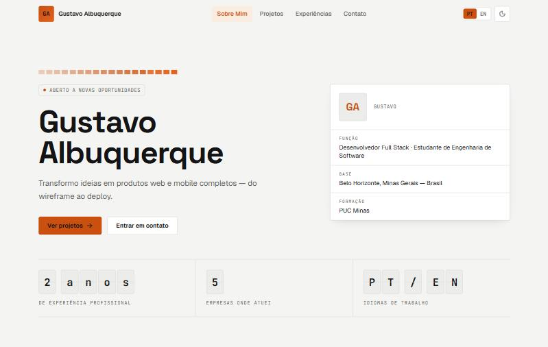 | 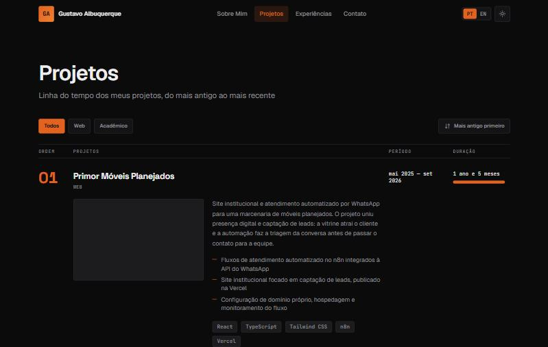 |

| Experiências | Contato |
|--------------|---------|
| 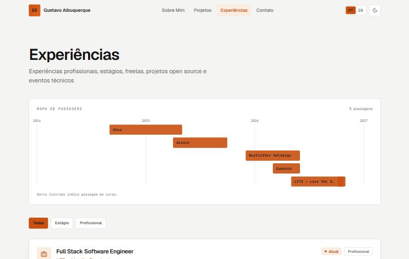 | 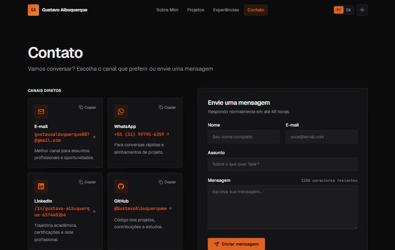 |

**Responsividade (390 px):**

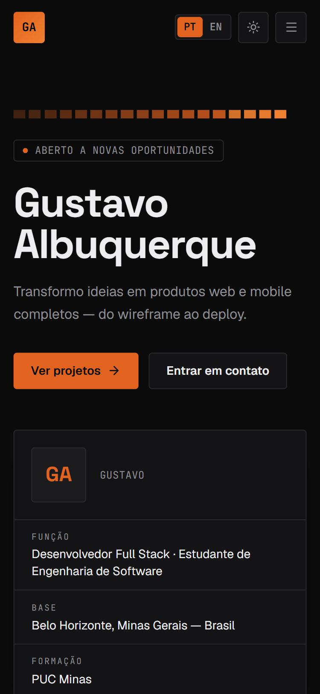 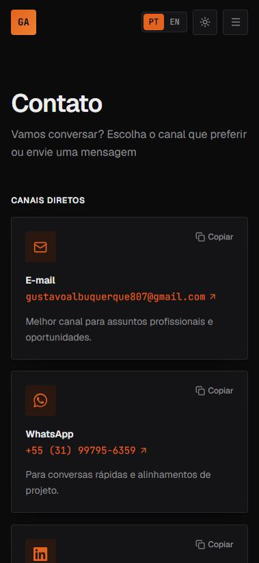

### 💻 Exemplo de Saída no Terminal

Build de produção:

```console
$ npm run build

▲ Next.js 16.4.2 (Turbopack)
✓ Compiled successfully in 7.2s
  Running TypeScript ...
  Finished TypeScript in 4.6s
✓ Generating static pages (7/7)

Route (app)
┌ ○ /
├ ○ /_not-found
├ ƒ /api/contact
├ ○ /contato
├ ○ /experiencias
└ ○ /projetos

○  (Static)   prerendered as static content
ƒ  (Dynamic)  server-rendered on demand
```

Testando a API de contato:

```console
$ curl -X POST http://localhost:3000/api/contact \
    -H "Content-Type: application/json" \
    -d '{"name":"Maria Souza","email":"maria@exemplo.com","subject":"Proposta de estágio","message":"Olá, gostaria de conversar sobre uma oportunidade."}'

{"ok":true,"delivered":true}
```

Payload inválido (validação no servidor):

```console
$ curl -X POST http://localhost:3000/api/contact \
    -H "Content-Type: application/json" \
    -d '{"name":"Ma","email":"invalido","subject":"Oi","message":"curta"}'

{"ok":false,"error":"validation_error","issues":{"name":["Too small: expected string to have >=3 characters"],"email":["Invalid email address"],"message":["Too small: expected string to have >=10 characters"]}}
```

---

## 🎨 Como Personalizar o Portfólio

Todo o conteúdo fica em `src/data/` — **nenhum componente precisa ser alterado**.

| O que mudar | Arquivo |
|-------------|---------|
| Nome, iniciais, cargo, localização, biografia (PT/EN), formação, indicadores | `src/data/profile.ts` |
| E-mail, WhatsApp, LinkedIn, GitHub | `src/data/profile.ts` → `socials` |
| Projetos da linha do tempo | `src/data/projects.ts` |
| Experiências | `src/data/experiences.ts` |
| Habilidades | `src/data/skills.ts` |
| Textos de interface (botões, títulos de seção) | `src/i18n/dictionaries.ts` |
| Cores, tipografia e temas | `src/app/globals.css` |

**Adicionar um projeto:**

```ts
// src/data/projects.ts
{
  id: "meu-projeto",
  name: "Meu Projeto",
  startDate: "2026-03",          // AAAA-MM, usado para ordenar a timeline
  endDate: null,                 // null = em andamento
  category: "web",               // "web" | "api" | "mobile" | "academic"
  description: { pt: "...", en: "..." },
  highlights: { pt: ["..."], en: ["..."] },
  technologies: ["Next.js", "TypeScript"],
  repository: "https://github.com/GustavoAlbuquerquee/meu-projeto",
  demo: "https://meu-projeto.vercel.app",     // opcional
  image: "/projects/meu-projeto.gif",         // arquivo em public/projects
}
```

**Trocar a foto de perfil:** coloque a imagem em `public/img/` e aponte `profile.avatar` para ela (ex.: `"/img/foto.jpg"`). Enquanto o valor for `null`, o site mostra as iniciais.

**Adicionar o currículo:** coloque o PDF em `public/` e aponte `profile.resume` (ex.: `"/curriculo.pdf"`). O botão de download aparece automaticamente.

---

## 🧪 Testes

A qualidade é garantida por verificação estática e pelo *pipeline* de CI, executados a cada push e pull request:

```bash
npx tsc --noEmit   # verificação de tipos em modo strict
npm run lint       # ESLint com as regras do Next.js
npm run build      # build de produção (falha em qualquer erro de tipo)
```

**Verificações manuais executadas:**

| Cenário | Resultado |
|---------|-----------|
| Navegação entre as quatro páginas (desktop e mobile) | ✅ |
| Troca de idioma PT ⇄ EN em todas as páginas | ✅ |
| Persistência de idioma e tema após recarregar a página | ✅ |
| Alternância de tema claro/escuro sem *flash* | ✅ |
| Filtros e inversão de ordem na linha do tempo de projetos | ✅ |
| Filtro por tipo na página de experiências | ✅ |
| Validação do formulário com campos vazios e e-mail inválido | ✅ |
| Envio do formulário com SMTP configurado | ✅ |
| Envio sem SMTP configurado (*fallback* `mailto:`) | ✅ |
| Layout responsivo em 390 px, 768 px e 1280 px | ✅ |
| Navegação apenas por teclado (Tab / Shift+Tab / Enter) | ✅ |
| Nenhum erro no console do navegador | ✅ |

> [!NOTE]
> Testes automatizados (Vitest para unidade e Playwright para E2E) estão previstos como evolução do projeto.

---

## 🔗 Documentações utilizadas

* 📖 **Framework (Front-end e Back-end):** [Documentação oficial do **Next.js** (App Router)](https://nextjs.org/docs)
* 📖 **Biblioteca de UI:** [Documentação oficial do **React**](https://react.dev/)
* 📖 **Linguagem:** [Handbook do **TypeScript**](https://www.typescriptlang.org/docs/)
* 📖 **Estilização:** [Documentação do **Tailwind CSS v4**](https://tailwindcss.com/docs)
* 📖 **Formulários:** [Documentação do **React Hook Form**](https://react-hook-form.com/get-started)
* 📖 **Validação:** [Documentação do **Zod**](https://zod.dev/)
* 📖 **Envio de e-mail:** [Documentação do **Nodemailer**](https://nodemailer.com/about/)
* 📖 **Animações:** [Documentação do **Motion**](https://motion.dev/docs)
* 📖 **Componentes de interação:** [**React Bits**](https://reactbits.dev/) — código de terceiros sob licença MIT + Commons Clause, mantido como veio da origem em [`src/components/reactbits/`](./src/components/reactbits), com o aviso de copyright preservado
* 📖 **Dados de corrida:** [**Jolpica F1 API**](https://github.com/jolpica/jolpica-f1), sucessora pública do Ergast, sem chave de acesso
* 📖 **Logos das tecnologias:** [**Simple Icons**](https://simpleicons.org/), em domínio público (CC0), copiados para [`public/stack/`](./public/stack)
* 📖 **Hospedagem:** [Documentação da **Vercel**](https://vercel.com/docs) · [**GitHub Pages**](https://docs.github.com/pages)
* 📖 **Acessibilidade:** [**WAI-ARIA Authoring Practices**](https://www.w3.org/WAI/ARIA/apg/)
* 📖 **Guia de Estilo:** [**Conventional Commits**](https://www.conventionalcommits.org/pt-br/v1.0.0/)

---

## 👥 Autores

| 👤 Nome | :octocat: GitHub | 💼 LinkedIn | 📤 Gmail |
|---------|------------------|-------------|----------|
| Gustavo Albuquerque | <div align="center"><a href="https://github.com/GustavoAlbuquerquee"></a></div> | <div align="center"><a href="https://www.linkedin.com/in/gustavo-albuquerque-6574402b4"></a></div> | <div align="center"><a href="mailto:gustavoalbuquerque807@gmail.com"></a></div> |

**Disciplina:** Desenvolvimento e Integração de Aplicações Web (DIAW)
**Curso:** Engenharia de Software — PUC Minas
**Professor:** [Prof. Dr. João Paulo Carneiro Aramuni](https://github.com/joaopauloaramuni)

---

## 🤝 Contribuição

1. Faça um `fork` do projeto.
2. Crie uma branch para sua feature (`git checkout -b feature/minha-feature`).
3. Commit suas mudanças (`git commit -m 'feat: adiciona nova funcionalidade X'`). **(Utilize [Conventional Commits](https://www.conventionalcommits.org/pt-br/v1.0.0/))**
4. Faça o `push` para a branch (`git push origin feature/minha-feature`).
5. Abra um **Pull Request (PR)**.

> [!IMPORTANT]
> 📝 Antes de abrir o PR, rode `npx tsc --noEmit`, `npm run lint` e `npm run build`. O pipeline de CI executa exatamente essas três verificações.

---

## 🙏 Agradecimentos

* [**Engenharia de Software PUC Minas**](https://www.instagram.com/engsoftwarepucminas/) — pelo apoio institucional, estrutura acadêmica e fomento às boas práticas de engenharia.
* [**Prof. Dr. João Paulo Aramuni**](https://github.com/joaopauloaramuni) — pela condução da disciplina e pelos ensinamentos sobre arquitetura de software e documentação de projetos.
* [**Comunidade Next.js e Vercel**](https://nextjs.org/) — pela documentação de altíssima qualidade e pela hospedagem gratuita que viabiliza projetos acadêmicos.
* [**Tailwind Labs**](https://tailwindcss.com/) e [**Lucide**](https://lucide.dev/) — pelas ferramentas abertas de estilização e iconografia.

---

## 📄 Licença

Este projeto é distribuído sob a **[Licença MIT](./LICENSE)**.

---
